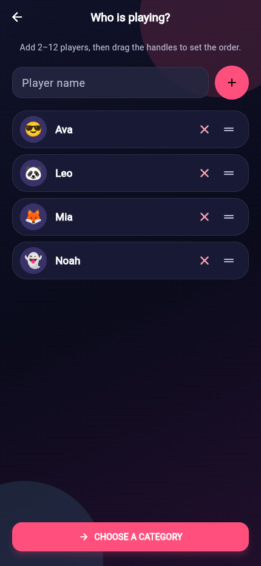
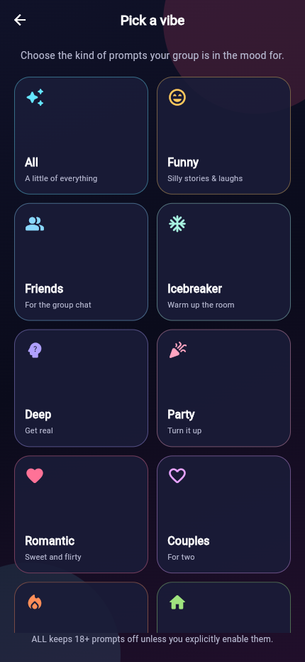
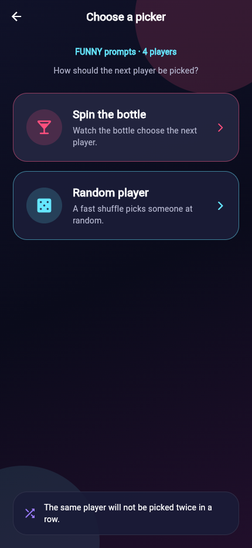
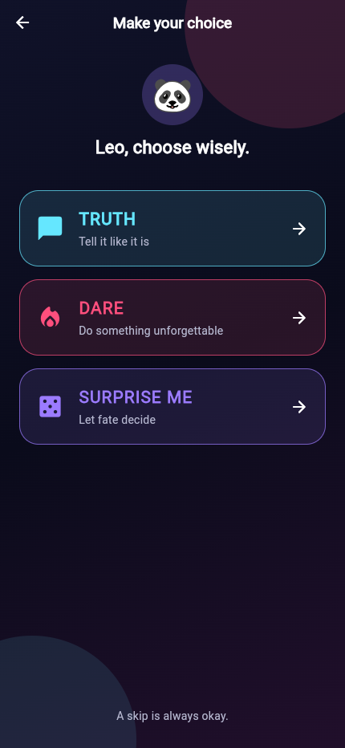
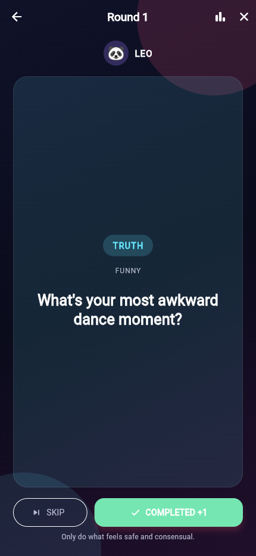
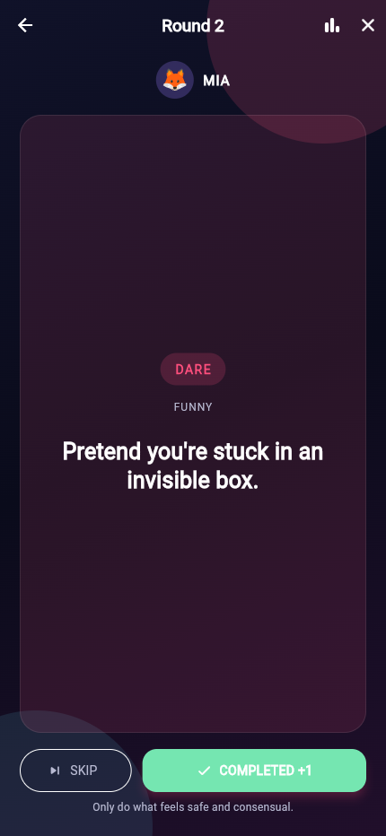
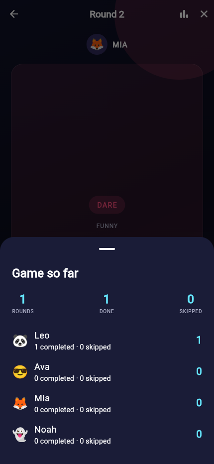
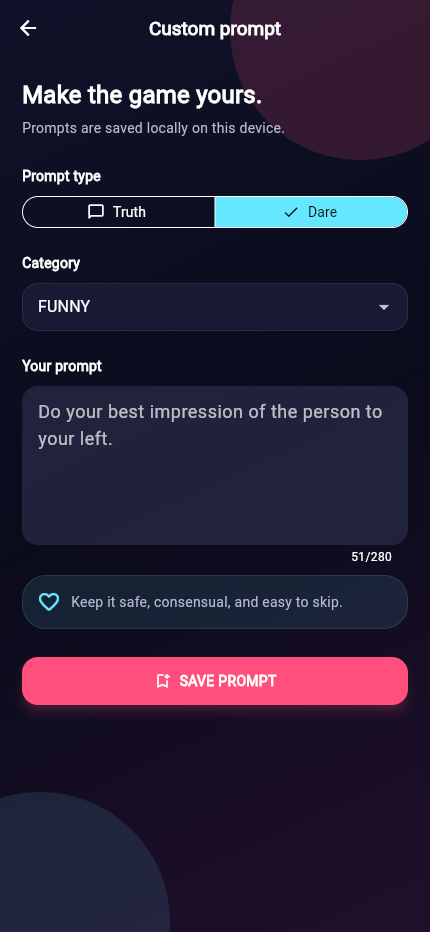
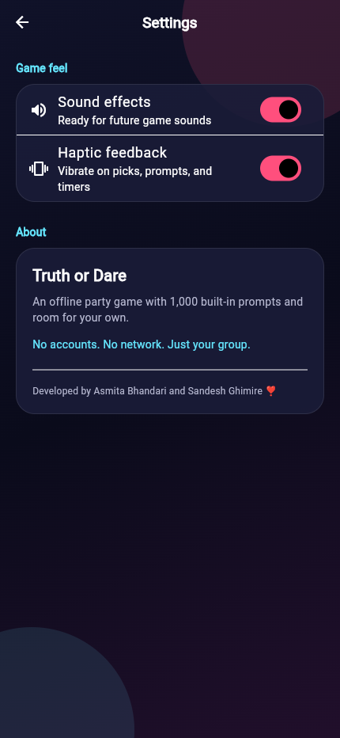

<p align="center">
  
</p>

<h1 align="center">Truth or Dare 😈</h1>

<p align="center">
  <strong>The party starts with one brave choice.</strong><br />
  An offline-first Flutter party game for friends, couples, families, and anyone with a group chat.
</p>

<p align="center">
  
  
  
  
</p>

---

## Overview

**Truth or Dare** is a fully offline Flutter party game. Add 2–12 players, pick a category and a picker style, then take turns choosing **Truth**, **Dare**, or **Surprise Me**. Every prompt can be completed or skipped, and the app keeps a live scoreboard for the group.

The app ships with **1,000 bundled prompts** — 500 truths and 500 dares across ten categories — plus a local form for writing your own. No accounts, no network calls, no tracking. Just your group.

> Play kind. Everyone can skip.

### Quick start

```powershell
# Replace this path with your clone if needed
cd "S:\august data\truth-and-dare\truth_or_dare"
flutter pub get
flutter run -d chrome
```

New machine or missing tools? Follow the [complete environment setup](#complete-environment-setup).

## Screenshots

<table>
  <tr>
    <td align="center"><br /><sub><b>Home</b></sub></td>
    <td align="center"><br /><sub><b>Player setup</b></sub></td>
    <td align="center"><br /><sub><b>Pick a category</b></sub></td>
  </tr>
  <tr>
    <td align="center"><br /><sub><b>Choose a picker</b></sub></td>
    <td align="center"><br /><sub><b>Spin the bottle</b></sub></td>
    <td align="center"><br /><sub><b>Make your choice</b></sub></td>
  </tr>
  <tr>
    <td align="center"><br /><sub><b>Truth</b></sub></td>
    <td align="center"><br /><sub><b>Dare</b></sub></td>
    <td align="center"><br /><sub><b>Game summary</b></sub></td>
  </tr>
  <tr>
    <td align="center"><br /><sub><b>Custom prompt</b></sub></td>
    <td align="center"><br /><sub><b>Settings</b></sub></td>
    <td align="center"><br /><sub><b>How to play</b></sub></td>
  </tr>
</table>

## Features

- 🎲 **1,000 built-in prompts** — 500 truths and 500 dares, evenly split across ten categories.
- 👥 **2–12 players** — unique names, colorful avatars, and drag-to-reorder turn order.
- 🍾 **Two picker modes** — spin the bottle or a fast random picker. The same player is never picked twice in a row.
- 🎯 **Three choices per turn** — Truth, Dare, or Surprise Me for a random pick.
- 🏆 **Live scoreboard** — +1 for an easy prompt, +2 for a hard prompt, with per-player completed and skipped counts.
- 🙈 **Skip anything** — no explanations, no penalty beyond the skipped stat.
- 🔞 **Age-gated 18+ category** — hidden from the pool unless explicitly enabled; mature prompts never appear in "All" by default.
- ✍️ **Custom prompts** — add your own truth or dare, assign it a category, and keep it on the device.
- 🌙 **Neon dark theme** — responsive Material 3 UI with glass cards and animated player picking.
- 📴 **Offline by design** — bundled question bank, local storage, and no network dependency.

## How it plays

1. **Add players** — give everyone a name (2–12 players); drag the handles to set the order.
2. **Pick a category** — All, Funny, Friends, Icebreaker, Deep, Party, Romantic, Couples, Bold, Family, or 18+.
3. **Choose a picker** — Spin the bottle or Random player.
4. **Make a choice** — Truth, Dare, or Surprise Me.
5. **Complete or skip** — every prompt counts toward the live scoreboard.
6. **Keep going** — the next player is picked and the round counter advances. Open the summary any time from the chart icon.

```text
Home → Players → Category → Picker mode → Player picker → Truth / Dare → Question ↺
```

## Prompt library

| Category   | Prompts | Vibe                   |
| ---------- | ------: | ---------------------- |
| Funny      |     100 | Silly stories & laughs |
| Friends    |     100 | For the group chat     |
| Icebreaker |     100 | Warm up the room       |
| Deep       |     100 | Get real               |
| Party      |     100 | Turn it up             |
| Romantic   |     100 | Sweet and flirty       |
| Couples    |     100 | For two                |
| Bold       |     100 | Brave choices          |
| Family     |     100 | Everyone friendly      |
| 18+        |     100 | Adults only            |
| **Total**  | **1000** | **500 truths · 500 dares** |

Bundled prompts live in [`assets/data/questions.json`](assets/data/questions.json). Each entry has an `id`, `type` (`truth` / `dare`), `category`, `intensity` (`easy` / `hard`), `text`, optional `timer`, `players`, `ageRating`, and `isCustom` flag.

```json
{
  "id": "funny_truth_001",
  "type": "truth",
  "category": "funny",
  "intensity": "easy",
  "text": "What's the dumbest thing you've ever done?",
  "timer": null,
  "players": "single",
  "ageRating": "13+",
  "isCustom": false
}
```

## Tech stack

| Layer            | Choice                                   | Notes                                                        |
| ---------------- | ---------------------------------------- | ------------------------------------------------------------ |
| Framework        | Flutter (Material 3)                     | Android, iOS, web, macOS, Windows, and Linux targets          |
| Language         | Dart                                     | SDK `^3.12.2`                                                |
| State management | [`provider`](https://pub.dev/packages/provider) | Single `ChangeNotifier` (`GameController`) drives the game    |
| Local database   | [`sqflite`](https://pub.dev/packages/sqflite) | Custom prompts on mobile and macOS                            |
| Preferences      | [`shared_preferences`](https://pub.dev/packages/shared_preferences) | Sound and haptic toggles                                      |
| Paths            | [`path`](https://pub.dev/packages/path) | Database file path resolution                                |
| Bundled data     | JSON asset                               | Loaded through `rootBundle`                                   |

## Project structure

```text
truth_or_dare/
├── assets/
│   └── data/questions.json                 # 1,000 bundled prompts
├── lib/
│   ├── core/
│   │   ├── models/
│   │   │   ├── player.dart                 # Player name, avatar, score, stats
│   │   │   └── question.dart               # Prompt model + JSON/SQLite mapping
│   │   ├── services/
│   │   │   ├── database_helper.dart        # SQLite setup, custom prompts
│   │   │   ├── game_controller.dart        # Game state, players, scoring, settings
│   │   │   └── question_repository.dart    # Merges bundled + custom prompts
│   │   ├── theme/app_theme.dart            # Dark Material 3 theme
│   │   └── widgets/game_ui.dart            # Palette, background, cards, buttons
│   ├── features/
│   │   ├── categories/screens/category_screen.dart
│   │   ├── custom_questions/screens/add_custom_question_screen.dart
│   │   ├── game/screens/
│   │   │   ├── player_mode_screen.dart     # Spin vs. random picker
│   │   │   ├── player_picker_screen.dart   # Animated bottle / shuffle
│   │   │   ├── prompt_type_screen.dart     # Truth / Dare / Surprise
│   │   │   └── question_screen.dart        # Prompt, timer UI, summary sheet
│   │   ├── home/screens/home_screen.dart
│   │   ├── players/screens/players_screen.dart
│   │   └── settings/screens/settings_screen.dart
│   └── main.dart                            # App entry point + Provider setup
├── test/widget_test.dart                    # Home screen smoke test
├── docs/screenshots/                        # README screenshots
└── pubspec.yaml
```

### Architecture notes

- `GameController` is the single source of truth for players, the current prompt, scoring, category selection, picker mode, and persisted settings. Screens read it with `context.watch` and mutate it with `context.read`.
- `QuestionRepository` merges the bundled JSON bank with custom rows from SQLite on every question draw.
- `Question` is shared between JSON and SQLite through `fromJson` / `toMap`.
- Navigation uses plain `MaterialPageRoute`s; the whole app is one `MaterialApp` with the dark theme applied globally.

## Complete environment setup

The commands below install a complete Flutter environment on **Windows 10/11**, then configure and run this exact project. Steps 1–4 and 7 are all you need for the web build used in the screenshots; Android and Windows desktop are optional.

> **Already have Flutter?** Run `flutter doctor -v` and `flutter devices`, then jump to **Step 7** below.

### Step 1 — install the core tools

Run these in PowerShell. `winget` installs the tools and accepts the license prompts for you:

```powershell
winget install --id Git.Git -e --source winget --accept-source-agreements --accept-package-agreements
winget install --id Google.Chrome -e --source winget --accept-source-agreements --accept-package-agreements
winget install --id Microsoft.VisualStudioCode -e --source winget --accept-source-agreements --accept-package-agreements
```

Close and reopen PowerShell afterwards so the updated `PATH` is picked up, then verify:

```powershell
git --version
code --version
```

Install the Flutter and Dart extensions for VS Code:

```powershell
code --install-extension Dart-Code.dart-code
code --install-extension Dart-Code.flutter
```

### Step 2 — install Flutter

The project requires Flutter **3.44 or newer** and Dart **3.12+**. Install the stable channel with Git:

```powershell
# Install Flutter to C:\flutter (skip if that folder already exists)
git clone https://github.com/flutter/flutter.git -b stable C:\flutter

# Add Flutter to the persistent user PATH
$flutterBin = "C:\flutter\bin"
$userPath = [Environment]::GetEnvironmentVariable("Path", "User")
if ($userPath -notlike "*$flutterBin*") {
    [Environment]::SetEnvironmentVariable("Path", "$userPath;$flutterBin", "User")
}

# Add it to the current terminal as well
if ($env:Path -notlike "*$flutterBin*") {
    $env:Path += ";$flutterBin"
}
```

> Prefer the official installer? Download the Windows SDK ZIP from [docs.flutter.dev/get-started/install/windows](https://docs.flutter.dev/get-started/install/windows), extract it to `C:\flutter`, and add `C:\flutter\bin` to your user `PATH`.

Verify and update:

```powershell
flutter --version
dart --version
flutter channel stable
flutter upgrade
flutter doctor -v
```

Enable the targets used by this project:

```powershell
flutter config --enable-web --enable-android --enable-windows-desktop
flutter config --list
```

### Step 3 — configure the environment

These checks should pass before running the app:

```powershell
flutter doctor -v
flutter devices
```

For this project's web run, `flutter devices` must list **Chrome**. A healthy web setup looks like:

```text
[✓] Chrome - develop for the web
    • Chrome at C:\Program Files\Google\Chrome\Application\chrome.exe

[✓] Connected device (2 available)
    • Windows (desktop) • windows • windows-x64
    • Chrome (web)      • chrome  • web-javascript
```

### Step 4 — configure Chrome (web target)

Chrome is normally auto-detected. If `flutter doctor` reports that Chrome cannot be found, point Flutter at it explicitly:

```powershell
Test-Path "C:\Program Files\Google\Chrome\Application\chrome.exe"

[Environment]::SetEnvironmentVariable(
    "CHROME_EXECUTABLE",
    "C:\Program Files\Google\Chrome\Application\chrome.exe",
    "User"
)
$env:CHROME_EXECUTABLE = "C:\Program Files\Google\Chrome\Application\chrome.exe"

flutter devices
```

If Chrome is installed in a different location, replace the path with the result of:

```powershell
Get-ItemProperty "HKLM:\SOFTWARE\Microsoft\Windows\CurrentVersion\App Paths\chrome.exe" | Select-Object -ExpandProperty "(default)"
```

### Step 5 — set up Android (optional)

Install Android Studio:

```powershell
winget install --id Google.AndroidStudio -e --source winget --accept-source-agreements --accept-package-agreements
```

Open Android Studio once and complete its setup wizard. In **Settings → Languages & Frameworks → Android SDK → SDK Tools**, install:

- Android SDK Platform (latest stable API)
- Android SDK Platform-Tools
- Android SDK Build-Tools
- Android SDK Command-line Tools (latest)
- Android Emulator
- A system image, for example **Google APIs Intel x86_64 Atom System Image**

Then configure the SDK paths and accept the licenses:

```powershell
$sdk = "$env:LOCALAPPDATA\Android\Sdk"

[Environment]::SetEnvironmentVariable("ANDROID_HOME", $sdk, "User")
[Environment]::SetEnvironmentVariable("ANDROID_SDK_ROOT", $sdk, "User")

$userPath = [Environment]::GetEnvironmentVariable("Path", "User")
if ($userPath -notlike "*$sdk\platform-tools*") {
    [Environment]::SetEnvironmentVariable(
        "Path",
        "$userPath;$sdk\platform-tools;$sdk\cmdline-tools\latest\bin",
        "User"
    )
}

$env:ANDROID_HOME = $sdk
$env:ANDROID_SDK_ROOT = $sdk
$env:Path += ";$sdk\platform-tools;$sdk\cmdline-tools\latest\bin"

# sdkmanager needs a JDK; use the one bundled with Android Studio
$jbr = "C:\Program Files\Android\Android Studio\jbr"
[Environment]::SetEnvironmentVariable("JAVA_HOME", $jbr, "User")
$env:JAVA_HOME = $jbr
$env:Path += ";$jbr\bin"

flutter config --android-sdk $sdk
flutter config --jdk-dir $jbr
sdkmanager --licenses
flutter doctor --android-licenses
flutter doctor -v
```

> Android Studio's bundled JDK is normally at `C:\Program Files\Android\Android Studio\jbr`. Adjust `$jbr` if you installed Android Studio somewhere else.

Create and launch an emulator:

```powershell
# See which system images are available (adjust the API level to one you installed)
sdkmanager --list | Select-String "system-images;android-"

# Example: install an API 36 image
sdkmanager --install "system-images;android-36;google_apis;x86_64"

flutter emulators
flutter emulators --create --name pixel_7
flutter emulators --launch pixel_7
flutter devices
```

> If `flutter emulators --create` cannot choose an image, open **Android Studio → Device Manager → Create Virtual Device**, select a Pixel device and an installed system image, then launch it. The emulator must be running before `flutter devices` will list it.

For a physical Android phone:

```powershell
# On the phone: enable Developer options → USB debugging, then connect it
adb devices
flutter devices
```

### Step 6 — set up Windows desktop (optional)

Windows desktop builds need Visual Studio with the **Desktop development with C++** workload:

```powershell
winget install --id Microsoft.VisualStudio.2022.Community -e --source winget `
  --accept-source-agreements --accept-package-agreements `
  --override "--wait --passive --add Microsoft.VisualStudio.Workload.NativeDesktop --includeRecommended"

flutter config --enable-windows-desktop
flutter doctor -v
flutter devices
```

You can also open the Visual Studio Installer later and add **Desktop development with C++** manually.

### Step 7 — set up and run the project

From PowerShell, enter the project folder and install dependencies:

```powershell
cd "S:\august data\truth-and-dare\truth_or_dare"

flutter pub get
flutter analyze
flutter test
flutter devices
```

> Replace the `cd` path with your own clone location if it differs.

Run the app:

```powershell
# Chrome — the command used to build the screenshots in this README
flutter run -d chrome

# Chrome on a fixed port, useful when you want a stable localhost URL
flutter run -d chrome --web-port 5173

# Let Flutter ask which device to use
flutter run

# A specific device from `flutter devices`
flutter run -d emulator-5554

# Windows desktop
flutter run -d windows

# Browser-less web server, then open http://localhost:8080 yourself
flutter run -d web-server --web-port 8080 --web-hostname 0.0.0.0
```

While the app is running, use the terminal keys:

| Key | Action                    |
| --- | ------------------------- |
| `r` | Hot reload                |
| `R` | Hot restart               |
| `q` | Quit the running app      |
| `d` | Detach and leave it running |

### Step 8 — build release artifacts

```powershell
# Web — output: build/web
flutter build web --release

# Android APK — output: build/app/outputs/flutter-apk/app-release.apk
flutter build apk --release

# Android App Bundle — output: build/app/outputs/bundle/release/app-release.aab
flutter build appbundle --release

# Windows — output: build/windows/x64/runner/Release/
flutter build windows --release
```

To preview the production web build locally:

```powershell
cd build\web
python -m http.server 8080
```

Then open `http://localhost:8080`. Any static file server works; Python is only an example.

### Step 9 — everyday commands and troubleshooting

```powershell
# Inspect the environment
flutter doctor -v
flutter config --list
flutter devices
flutter emulators

# Dependencies and code quality
flutter pub get
flutter pub upgrade
flutter analyze
dart format lib test
flutter test

# Cleanup when the build gets stale
flutter clean
flutter pub get
flutter pub cache repair

# Update Flutter itself
flutter upgrade
```

| Problem                                      | Fix                                                                                                 |
| -------------------------------------------- | --------------------------------------------------------------------------------------------------- |
| `flutter` is not recognized                  | Reopen PowerShell, or re-add `C:\flutter\bin` to the user `PATH` and run `Get-Command flutter`.      |
| Chrome is not listed in `flutter devices`     | Set `CHROME_EXECUTABLE` (Step 4), then rerun `flutter devices`.                                     |
| `cmdline-tools component is missing`         | Install **Android SDK Command-line Tools (latest)** in Android Studio's SDK Manager.                |
| `Android license status unknown`             | Run `flutter doctor --android-licenses` and accept every prompt.                                    |
| No Android device found                      | Run `flutter emulators`, launch one, or check `adb devices` for a physical phone.                   |
| Windows build fails                          | Install the **Desktop development with C++** workload in Visual Studio.                             |
| Port already in use                          | Use another port: `flutter run -d chrome --web-port 8080`.                                           |
| Stale code, missing plugins, or odd build errors | Run `flutter clean`, then `flutter pub get`, then rebuild.                                      |
| Custom prompt cannot be saved in Chrome      | Expected on web: `sqflite` has no web backend. See [Platform support](#platform-support).           |

Useful diagnostics:

```powershell
# Which Flutter executable is actually running?
Get-Command flutter
$env:Path -split ";" | Select-String -Pattern "flutter"

# Confirm Chrome exists at the expected path
Test-Path "C:\Program Files\Google\Chrome\Application\chrome.exe"

# Check the Android toolchain
adb devices
flutter doctor --android-licenses
```

### macOS and Linux quick start

The project itself is cross-platform. Use these commands on other operating systems, then run the same project commands from Step 7.

```bash
# macOS — Homebrew
brew install --cask flutter

# macOS — manual install
git clone https://github.com/flutter/flutter.git -b stable ~/flutter
echo 'export PATH="$HOME/flutter/bin:$PATH"' >> ~/.zshrc
source ~/.zshrc
flutter doctor

# Ubuntu / Debian — Snap
sudo snap install flutter --classic

# Ubuntu / Debian — Linux desktop prerequisites
sudo apt update
sudo apt install clang cmake ninja-build pkg-config libgtk-3-dev
flutter doctor
```

iOS and macOS builds require a Mac with Xcode and CocoaPods. Install Chrome (or Edge) for web development on any platform.

## Data, scoring, and storage

- **Prompt selection** avoids repeating prompts until the eligible pool is exhausted. After a reset, the immediately previous prompt is skipped when possible.
- **Scoring** awards 1 point for an `easy` prompt and 2 points for a `hard` prompt. The summary sheet ranks players by score and shows rounds, completions, and skips.
- **18+ filtering** happens in the repository: mature prompts are excluded unless the 18+ category was explicitly confirmed.
- **Custom prompts** are inserted with `isCustom = 1` and a timestamp-based ID, then merged into future question pools.
- **Settings** are written to `shared_preferences`; the in-memory value still applies if storage is unavailable.

### Platform support

| Platform            | Gameplay | Custom prompt persistence | Notes                                             |
| ------------------- | :------: | :-----------------------: | ------------------------------------------------- |
| Android / iOS       |    ✅    |            ✅             | Full support via `sqflite`                        |
| macOS               |    ✅    |            ✅             | Full support via `sqflite`                        |
| Web (Chrome/Edge)   |    ✅    |            —              | `sqflite` has no web backend; the UI reports that the prompt cannot be saved |
| Windows / Linux     |    ✅    |            —              | Would need `sqflite_common_ffi` to persist custom prompts |

Gameplay, scoring, bundled prompts, pickers, and settings all work on every target. Haptics are a no-op on web and desktop, and the sound toggle is a placeholder for future audio.

## Known limitations

- Custom prompt **persistence** is limited to platforms with a `sqflite` backend (see table above); web and desktop still show the form and fail gracefully.
- The sound effects switch is present but no audio assets are wired up yet.
- The countdown timer UI is implemented, but none of the bundled prompts currently include a `timer` value, so it does not appear during a default game.
- There is no license file in the repository yet. Add one before distributing the project.

## Verification

This README was generated from a full manual pass of the app:

- `flutter analyze` → no issues
- `flutter test` → home screen smoke test passes
- `flutter run -d chrome` → all screens above were exercised and captured at a 430 × 932 mobile viewport
- Environment used: Flutter 3.44.6 · Dart 3.12.2 · Chrome 156 · Windows 11

<p align="center"><sub>Built with Flutter · Developed with ❣️ by <strong>Asmita Bhandari</strong> and <strong>Sandesh Ghimire</strong></sub></p>
